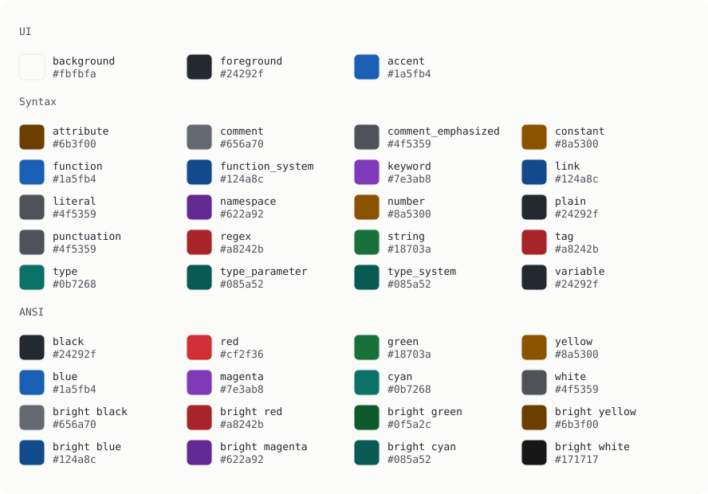
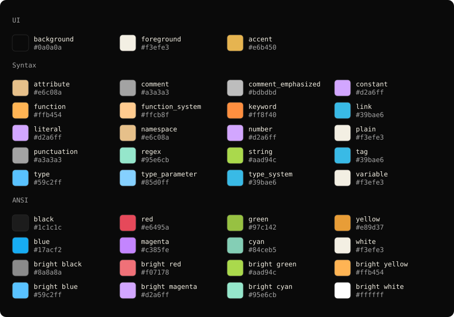
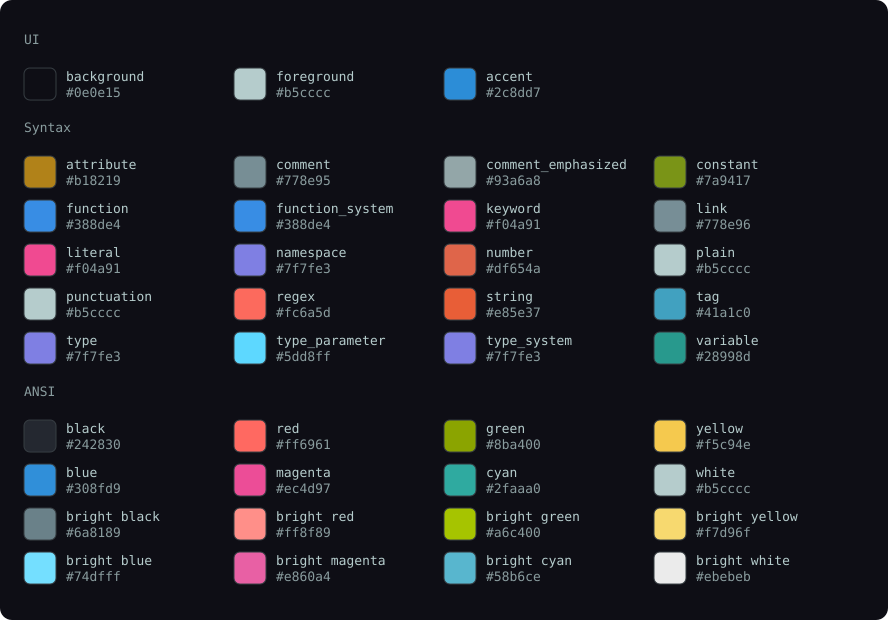

# Brzz Themes

Editor and terminal themes for Claude Code, Ghostty, herdr, the Herdr desktop app, NetNewsWire, Rex, Slack, VS Code, Xcode 27, and Zed, in three families:

- **Geist**: Geist Dark and Geist Light, built from the colours of Vercel's [Geist terminal themes](https://vercel.com/geist/terminal).
- **Ayu**: Ayu Dark Contrast, [ayu](https://github.com/ayu-theme/ayu-colors)'s dark theme on a neutral black with brighter text, for easier focus. Its Zed and VS Code themes are ayu's own for those apps, with the backgrounds, text, and greys swapped, along with any colour that falls short of 4.5:1.
- **Brzz**: Brzz Dark, the colours of [John Sundell's Xcode theme](https://github.com/JohnSundell/XcodeTheme), each lightened only as far as 4.5:1 needs, with softer fills behind code, for long sessions.

This is an unofficial project, not made or endorsed by Vercel, the ayu project, or John Sundell. Geist's colours belong to Vercel's Geist design system, ayu's to its authors under the MIT licence, and Brzz's starting colours to John Sundell's Xcode theme, also under the MIT licence.

<picture>
  <source media="(prefers-color-scheme: dark)" srcset="docs/screenshots/ghostty-dark.webp">
  
</picture>

## Palette

<picture>
  <source media="(prefers-color-scheme: dark)" srcset="docs/palette-geist-dark.svg">
  
</picture>





## Install

### Claude Code

Copy the Claude Code themes into the `themes/` folder of your Claude Code config directory, `~/.claude` unless `CLAUDE_CONFIG_DIR` points elsewhere:

```sh
themes="${CLAUDE_CONFIG_DIR:-$HOME/.claude}/themes"
mkdir -p "$themes"
cp claude-code/*.json "$themes/"
```

Then pick a theme, such as **Geist Dark** or **Ayu Dark Contrast**, with `/theme`. Claude Code reloads the folder while it runs, but restart it once if `themes/` didn't exist when it started. Its **auto** theme switches only between the built-in themes, so a custom theme doesn't follow the system appearance.

### Ghostty

Copy the Ghostty themes into `~/.config/ghostty/themes/`:

```sh
mkdir -p ~/.config/ghostty/themes
cp ghostty/* ~/.config/ghostty/themes/
```

Then set `theme = Geist Dark`, `theme = Geist Light`, `theme = Ayu Dark Contrast`, or `theme = Brzz Dark` in your Ghostty config. To follow the system appearance, pair a light and a dark theme, such as `theme = light:Geist Light,dark:Ayu Dark Contrast`.

<picture>
  <source media="(prefers-color-scheme: dark)" srcset="docs/screenshots/ghostty-dark.webp">
  
</picture>

### herdr

herdr can't load a separate theme file, so paste the contents of `herdr/geist.toml`, `herdr/ayu.toml`, or `herdr/brzz.toml` into `~/.config/herdr/config.toml`, replacing the `[theme]` table and every `[theme.custom]`, `[theme.custom.dark]` and `[theme.custom.light]` table already there. Keep any other `[theme]` keys you want, such as `name`, under the pasted `[theme]` header. Then run:

```sh
herdr server reload-config
```

Geist's snippet turns on `auto_switch`, so herdr uses Geist Dark or Geist Light to match the colour scheme your terminal reports. Ghostty reports dark only with a conditional theme, so a fixed `theme = Geist Dark` still reports light and herdr picks Geist Light. In Ghostty, use a conditional theme instead, such as `theme = light:Geist Light,dark:Geist Dark`, as the [Ghostty](#ghostty) section describes. To keep herdr on Geist Dark instead, pick a theme in herdr's settings, which turns `auto_switch` off and leaves Geist Dark. The snippet sets every colour herdr themes, so it looks the same whichever base theme `theme.name` picks. Ayu and Brzz have no light theme, so their snippets leave `auto_switch` off and herdr stays on their dark theme.

<picture>
  <source media="(prefers-color-scheme: dark)" srcset="docs/screenshots/herdr-dark.webp">
  
</picture>

### Herdr desktop app

For Herdr 0.1.15 or later. Copy the Herdr desktop themes into `~/.config/herdr-app/themes/`:

```sh
mkdir -p ~/.config/herdr-app/themes
cp herdr-app/*.json ~/.config/herdr-app/themes/
```

Then pick a dark theme, such as **geist dark** or **ayu dark contrast**, and **geist light** as the light one in Settings → Look. Each layout keeps its own pair, so pick them in every layout you use. Herdr follows the system appearance between the two.

### NetNewsWire

With NetNewsWire running, open `netnewswire/Geist.nnwtheme`, `netnewswire/Ayu.nnwtheme`, or `netnewswire/Brzz.nnwtheme` and accept the install prompt. Opening it while NetNewsWire is closed only launches the app, so open it again. Then pick **Geist**, **Ayu**, or **Brzz** in NetNewsWire → Settings → General → Article Theme. Geist's article view follows the system appearance between Geist Dark and Geist Light; Ayu's and Brzz's stay dark.

<picture>
  <source media="(prefers-color-scheme: dark)" srcset="docs/screenshots/netnewswire-dark.webp">
  
</picture>

### Rex

Rex imports the Ghostty files. In its Settings → Themes → Import Theme, click **Import** and pick `ghostty/Geist Dark`, then do the same for `ghostty/Geist Light`. Rex files each theme under the appearance it matches and selects it there, so Dark Mode uses **Geist Dark** and Light Mode uses **Geist Light**. Importing `ghostty/Ayu Dark Contrast` or `ghostty/Brzz Dark` as well selects it for Dark Mode in Geist Dark's place. To return to them after picking another theme, select them again on the same page.

A Rex theme has no key for the sidebar: with **Tint with theme** on, Rex shades it from the theme, and otherwise uses macOS's own shade. For Geist Dark, pick **Glass** under Settings → Interface → Appearance → Interface style. In **Classic**, the selected tab barely shows against the black; in Glass it shows clearly.

<picture>
  <source media="(prefers-color-scheme: dark)" srcset="docs/screenshots/rex-dark.webp">
  
</picture>

### Slack

Slack's custom themes set only four colours: the sidebar, selected items, presence, and the unread badge. Slack picks the rest, so its message pane keeps Slack's own grey in dark mode. In Slack → Preferences → Appearance, pick **Dark** under Colour mode, then under Custom theme click **Import** and paste the line from `slack/Geist Dark.txt`, `slack/Ayu Dark Contrast.txt`, or `slack/Brzz Dark.txt`. For light mode, pick **Light** and paste `slack/Geist Light.txt` instead. Leave **Window gradient** off.

### VS Code

Package the extension with Node installed:

```sh
cd vscode && npx --yes @vscode/vsce package -o brzz-themes.vsix
```

Brzz Themes replaces the earlier `geist-themes` extension, so uninstall that first if you have it. In VS Code (or a fork such as Cursor), run **Extensions: Install from VSIX…** and pick `vscode/brzz-themes.vsix`, then choose **Geist Dark**, **Geist Light**, **Ayu Dark Contrast**, or **Brzz Dark** with **Preferences: Color Theme**.

<picture>
  <source media="(prefers-color-scheme: dark)" srcset="docs/screenshots/vscode-dark.webp">
  
</picture>

### Xcode 27

Xcode 27 keeps themes in its settings rather than in `.xccolortheme` files. Quit Xcode, then run:

```sh
./install-xcode.py
```

Then, in Xcode → Settings → Appearance → Theme → **Choose…**, pick **Geist Dark**, **Ayu Dark Contrast**, or **Brzz Dark** for the dark appearance and **Geist Light** for the light one. Running it again updates the themes in place.

<picture>
  <source media="(prefers-color-scheme: dark)" srcset="docs/screenshots/xcode-dark.webp">
  
</picture>

### Zed

Copy `zed/geist.json`, `zed/ayu.json`, and `zed/brzz.json` into `~/.config/zed/themes/` (`zed/ayu.LICENSE` is the licence of the Zed theme `zed/ayu.json` is made from), then pick **Geist Dark**, **Geist Light**, **Ayu Dark Contrast**, or **Brzz Dark** with `cmd-k cmd-t`.

<picture>
  <source media="(prefers-color-scheme: dark)" srcset="docs/screenshots/zed-dark.webp">
  
</picture>

## Changing colours

Every theme, and each palette card under `docs/`, is generated from `palettes/`. Each family of themes has its own folder there: `family.toml` holds the family's name, the name its NetNewsWire theme identifier derives from, its source credit, and its disclaimer; every other `.toml` is one theme's palette. Edit a palette, then regenerate:

```sh
./build.py
```

Commit the palette and the generated files together. CI fails when they disagree.
